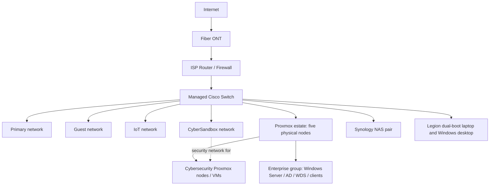

# Home Lab Infrastructure | Alec Agen

**Enterprise infrastructure, virtualization, identity, storage, security segmentation, and operations**

A personal, self-designed and self-administered infrastructure lab built to develop enterprise IT administration skills, experiment with cybersecurity, support software and AI development, and centralize personal computing and storage.

This is an **architecture and operations case study**, not a deployable reference implementation. It documents an existing personal environment while deliberately withholding live network and management details.

> **Security and accuracy notice:** IP addresses, subnets, gateways, VLAN IDs, domain names, hostnames, serial numbers, management endpoints, and detailed firewall rules are intentionally omitted or represented as `xxx.xxx.xxx.xxx`. Some HA, routing, and storage details are based on recollection and are marked **unverified** rather than presented as independently tested.

## At a glance

| Domain | Technologies and design |
| --- | --- |
| Network edge | Fiber ONT, ISP router/firewall, managed Cisco switching |
| Segmentation | Primary, Guest, IoT, and CyberSandbox networks; isolation policy reported, individual rules unverified |
| Virtualization | Five bare-metal Dell OptiPlex Micro Proxmox nodes |
| Enterprise lab | Windows Server, Active Directory, OUs, GPOs, security groups, domain-joined clients, file shares and permissions, WDS |
| Security lab | Kali Linux, Fedora, and Parrot OS (installed, not yet used) |
| Additional workloads | Docker containers, development environments, VM templates |
| Storage | Two Synology NAS appliances; local and network-attached Proxmox storage |
| Monitoring and management | Uptime Kuma, Homepage, Proxmox Datacenter Manager |
| Physical resilience | UPS-backed equipment and a managed PDU |
| Workstations | Fedora/Windows dual-boot Legion laptop; separate Windows desktop |

## Logical network overview

The following diagram deliberately shows **functional relationships**, not actual addressing, port mappings, or verified VLAN uplink configuration.

*CyberSandbox is the network/security zone used by the Proxmox cybersecurity VM environment, not a separate set of devices. Exact VLAN tagging, cabling, and wireless paths are omitted; the dotted connection describes logical association rather than an independently verified port or tag configuration.*

## Selected engineering decisions

- **Virtualization:** Bare-metal hypervisors and reusable Proxmox VM templates support repeatable lab environments.
- **Enterprise simulation:** A Windows domain provides hands-on practice with identity, policy, endpoint management, deployment, and access permissions.
- **Segmentation:** Separate trust zones reduce the intended reach of guest, IoT, and cybersecurity-testing devices. Actual rule effectiveness has not been independently validated.
- **Storage:** Local VM disks and NAS-backed VM storage are both in use; primary NAS data and backup-target roles are separate.
- **Recovery:** Proxmox lab workloads are considered disposable and do not receive routine VM backups. This is a risk acceptance, **not** an HA or backup claim.
- **Operations:** Central service visibility, hypervisor management, and UPS power protection support daily administration.

## Documentation

- [Architecture and virtualization](docs/architecture.md)
- [Network segmentation and redaction](docs/network-security.md)
- [Physical layout, storage, and operations](docs/physical-and-operations.md)

## Current vs planned

**Reported operational:** Core network, segmented networks, Proxmox workloads, Windows domain services, WDS, NAS systems, monitoring dashboards, UPS and managed PDU.

**Unverified details:** Exact Proxmox cluster/quorum structure and HA failover behavior; NAS storage protocol; firewall policy evaluation; domain DNS assignment; automated recovery guarantees.

**Planned, not deployed:** Tailscale remote access.

## What this demonstrates

Infrastructure planning and administration across physical networking, virtualization, Windows domain services, lab isolation, storage, power, and monitoring—plus the ability to communicate a real environment through security-conscious documentation.

**Scope note:** No private network addresses, credentials, device serials, or production configuration exports are included.
