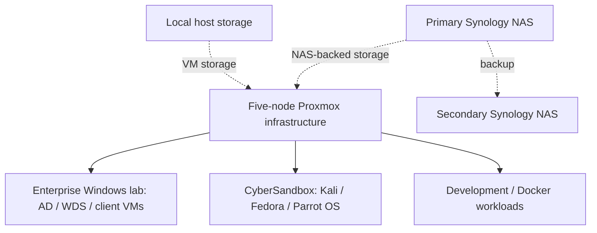

# Compute and virtualization architecture

## Physical compute

- **Five Dell OptiPlex Micro systems**, running Proxmox VE directly on hardware
- Enterprise Windows and CyberSandbox workloads are hosted across the Proxmox environment.
- Proxmox Datacenter Manager is used for infrastructure management; no specific HA or quorum configuration is claimed.

## Workload groups

### Enterprise Windows environment

- Windows Server with Active Directory Domain Services
- Organizational units and Group Policy Objects
- Security groups and domain-joined client VMs
- Network file share and access permissions
- Windows Deployment Services (WDS) for imaging/deployment exercises

Domain names, hostnames, user identities, GPO settings, and permissions are omitted.

### CyberSandbox: Proxmox cybersecurity environment

The Proxmox cybersecurity VMs constitute the **CyberSandbox lab** and its associated security zone.

- Kali Linux
- Fedora Linux
- Parrot OS — installed but not yet used

Most cybersecurity lab machines can reach the internet; one machine is deliberately kept offline. Internet reachability and inter-VLAN access are distinct controls.

### Development and additional services

- Docker containers and development environments
- Proxmox VM templates for provisioning standardization
- No claim of Terraform, Ansible, GitOps, or automated configuration management

## Storage integration

VM disks use both **host-local disks** and NAS-backed network storage. The **secondary Synology NAS** is the backup target for primary NAS data. No live-migration or automatic failover capability is claimed.

## Recovery posture

The VM estate is used for experimentation and does not currently have scheduled VM backups by design. VM workloads are treated as rebuildable; no recovery-time guarantee is made. High availability does not replace backups.

## Workload overview

*Functional view only; individual VM placement and physical network details are omitted.*
