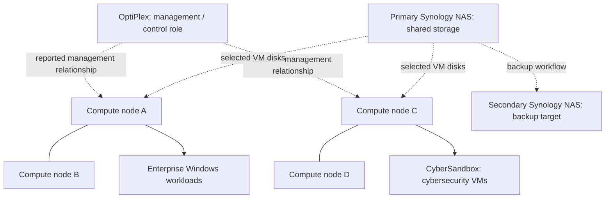

# Compute and virtualization architecture

## Physical compute

- **Five Dell OptiPlex Micro systems**, running Proxmox VE directly on hardware
- **One management/control-role node** and **two pairs of compute nodes**, per operator recollection
- HA believed to be configured for the compute groups, but exact cluster membership, quorum arrangement, fencing, and restart/migration behavior **have not been verified**

A management-role host does not necessarily mean a separate Proxmox control-plane architecture. This document does not claim that two independent two-node Proxmox clusters safely provide HA without quorum support.

## Workload groups

### Enterprise Windows environment

- Windows Server with Active Directory Domain Services
- Organizational units and Group Policy Objects
- Security groups and domain-joined client VMs
- Network file share and access permissions
- Windows Deployment Services (WDS) for imaging/deployment exercises

Domain names, hostnames, user identities, GPO settings, and permissions are omitted.

### CyberSandbox: Proxmox cybersecurity environment

The cybersecurity compute nodes and their VMs constitute the **CyberSandbox lab**, rather than a separate environment alongside that network zone. Exact virtual NIC assignments and VLAN tagging are not independently verified.

- Kali Linux
- Fedora Linux
- Parrot OS — installed but not yet used

Most cybersecurity lab machines can reach the internet; one machine is deliberately non-internet-facing according to the operator. Internet reachability and inter-VLAN access are distinct controls.

### Development and additional services

- Docker containers and development environments
- Proxmox VM templates for provisioning standardization
- No claim of Terraform, Ansible, GitOps, or automated configuration management

## Storage integration

VM disks use both **host-local disks** and network storage on the **primary Synology NAS** (exact VM placement unverified). The **secondary Synology NAS** serves as the separate backup target for primary NAS data, not as an independently confirmed VM datastore. Storage transport and live-migration eligibility are unverified. In particular, shared storage alone does not prove HA failover.

## Recovery posture

The VM estate is used for experimentation and does not currently have scheduled VM backups by design. VM workloads can be recreated if necessary, but a measured recovery time has not been established. High availability does not replace backups.

## Illustrative virtualization grouping

*Logical grouping from recollection only: not a representation of confirmed cluster membership, quorum, HA dependencies, or the physical distribution of individual VMs. CyberSandbox is the security-testing compute environment and associated network zone.*
