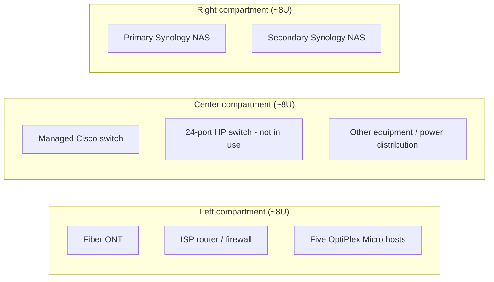

# Physical infrastructure, storage, and operations

## Equipment layout

A repurposed TV stand provides three equipment compartments with approximately 8U of usable volume apiece. It is **not** represented as a standard 24U rack.

UPS and managed-PDU placement, cabling runs, and physical dimensions are omitted from this public overview.

## Storage

- **Primary Synology NAS:** files, synchronization, development resources, and NAS-backed lab storage.
- **Secondary Synology NAS:** separate local backup target for the primary NAS, previously described as using Hyper Backup Vault.
- Earlier configuration included Synology Drive, Hyper Backup, and Hyper Backup Vault. Backup schedules and job status are intentionally not detailed in this public portfolio.
- Synology RAID/SHR provides disk fault tolerance where configured, not an independent backup or disaster-recovery plan.
- Both NAS devices are on site and separate devices. Local NAS-to-NAS backup alone is not a complete off-site 3-2-1 strategy.

## Clients

- Lenovo Legion Pro 7: Fedora / Windows dual boot, development and local AI workloads
- Separate Ryzen-based Windows desktop with NVIDIA GPU
- Per-device network interfaces are not published

## Monitoring and administration

- **Uptime Kuma:** service availability checks
- **Homepage:** consolidated service dashboard
- **Proxmox Datacenter Manager:** Proxmox estate administration and visibility
- Native management interfaces are also used for lab equipment

## Power and recovery

- Equipment is connected to UPS battery protection.
- Power distribution includes a managed PDU.
- Automated UPS-triggered shutdown has **not** been configured.
- Tailscale remote access is **planned**, not operational.
- Proxmox VM backups are deliberately not configured for disposable lab workloads.

## Scope of documentation

The goal is to communicate design choices, operation, and tradeoffs, not to expose live infrastructure. No IP addresses, network ranges, hostnames, credentials, serial numbers, management URLs, or exact switch firmware information are disclosed.
